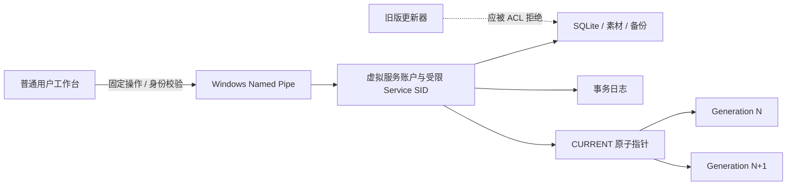

# 数据管理服务隔离设计（未部署）

## 现状与范围

当前主程序直接创建 `Storage`、调用 `_session` 并读取 `HOME/references`；`storage.py` 直接访问 SQLite、素材与备份；`updater.py` 直接持有数据路径并替换文件。`tools/build_windows_portable.py` 打包现有源码及运行环境，没有 Windows 服务安装。受保护代次、服务账户、ACL 和命名管道均未部署。原应用和旧更新器仍能绕过服务，隔离门禁未通过。

## 接口与权限边界

拟采用固定操作集合：案例/单品/提示词按 ID 读写，附件分块上传和按 ID 下载，备份创建、经授权恢复、代次状态查询。服务端拒绝绝对路径、目录遍历、未知操作和未经验证的标识；资产归属、版本、请求大小及跨案例关系在服务端复核。备份恢复、维护和普通业务权限分离。Named Pipe 使用受限 DACL，连接后读取并校验客户端令牌和 SID；不能以客户端提供的用户名、PID 或 JSON 字段代替授权。并发、重放、请求体限制和断线取消需完整设计和测试。当前代码只包含无传输层的只读操作分派实验，尚无身份认证或管道。

## Generation 实验

`data_service_prototype.py` 仅接受系统临时目录：写入独立代次、逐文件 SHA-256、SQLite integrity/foreign-key 检查，使用持久临时文件加 `os.replace` 切换 CURRENT，并以 PREPARED/COMMITTED 日志在下一次调用时回滚或确认。它不是 ZIP 恢复、服务进程或 OS 级不可变存储；Windows 目录元数据持久化、掉电原子性、NTFS 重解析点及并发排他均未验证，不能作为生产数据协议。旧代次保留，失败生成物不自动清理。

## Windows 安装与回滚方案草案

候选部署应由已签名、可审计的安装器以管理员授权创建独立虚拟服务账户、受限 Service SID 和最小权限 DACL；普通应用身份不得直接访问受保护数据，管理员保留维护权限。安装前应先在快照 VM 验证身份、管道客户端访问控制、系统服务重启、继承 ACL、目录联接以及旧版 updater 的拒绝访问；任一失败必须保持现有数据目录和程序可用。卸载应先停止服务、撤销服务注册并保留数据和备份，删除数据必须另经明确授权。安装、卸载、异常回滚与升级不应依赖网络或复制用户凭据。

尚无可交付的服务二进制、安装器和 ACL 清单，不能提供可安全执行的一次性管理员命令。真实安装前需列出将创建的服务、身份、管道、受保护目录及 ACL，并提供离线备份、恢复旧程序和卸载保留数据步骤，供用户单独批准。本轮不创建账户、不安装服务、不修改 ACL、不迁移真实数据。管理员进程不在本威胁模型的防护范围内。

正式迁移前须通过独立身份下真实 Windows 权限测试，证明普通应用和旧更新器不能直接读写或替换 V2；同时完成真实 ZIP、故障注入及 Windows/Linux 回归。禁止以代码路径约束代替文件系统权限隔离。
