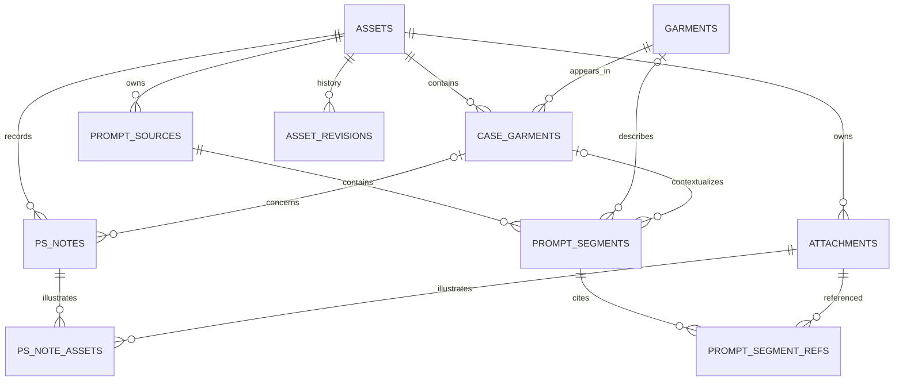

# 阶段 2 数据库只读审查与设计

审计对象为阶段 1 验证提交 74c9c28855b13dabe10458fdcd62f58f35d9399d。仅分析仓库结构，未读取真实用户数据库，实际数据数量、脏数据和文件完整性待迁移预检。

## A–J 数据现状和设计决定

A. 现有九表为 metadata、assets、asset_revisions、attachments、scan_sources、ingest_files、generation_feedback、retrieval_feedback、ai_analyses。确切定义与索引见 storage.py:143。assets 包含 case/module 和 payload_json；asset_revisions 保存快照，attachments 的 asset_id 引用 assets 并级联删除；ingest_files 引用 scan_sources 并级联删除。generation_feedback、retrieval_feedback 的 case_id 与 ai_analyses 的 approved_asset_id 未声明外键。各表主键、唯一约束及索引以该 DDL 为准。

B. 复用 assets 案例、模块及其稳定 ID，asset_revisions、attachments、扫描与分析记录、存储事务和完整备份。assets 并非独立服装表。

C. 新增 garment、case_garment、原文版本、片段、片段引用和 PS 记录；附件的当前唯一性为资产内路径与角色，跨案例共享素材还需单独引入内容文件实体。

D. 可以回填有明确案例归属的现有原文、附件记录和 outfit_items；原始值、历史 payload 均保留。旧提示词偏移须严格匹配后才能建立精确片段，缺失时标注待审。

E. 跨案例同款、无唯一依据的服装身份、旧描述归属、素材引用、生成结果和 PS 建议均需人工确认。相同款号只给出候选，不能静默合并。

F. 新表采用增量迁移。旧版 save_data 为全量集合替换，删除 assets 可触发附件级联，且旧版不认识新关系。迁移前须制定旧版本只读或拒绝写入的版本门禁；不能声称旧版可安全写入。新旧接口需维护一致性并对旧备份与 JSON 导入制定补全策略。

G. 升级前在独占维护窗口创建并验证包含 SQLite、JSON、图片的完整备份。事务内失败回滚 SQLite；跨文件或新版本启动失败走阶段 1 独立更新器恢复完整快照，保留故障现场。已使用新数据后回滚至旧版必须先另存新库和文件，防止丢失期间产生的数据。旧版本恢复与反向迁移需要实测。

H. 现有 case_matcher 对 cases 的属性和 outfit_items 评分。兼容期保留 payload 和索引语义，新单品检索通过明确适配层加入；比较旧查询结果并回归跨单品误匹配。禁止迁移时静默改变评分。

I. ai_analyzer.py:170 分析输入文件及 1–8 张图片，224 行仅发送前 50000 字符，296 行保留完整原文。storage.py:783 的人工批准路径需要在同一事务建立来源和关联，仍保留待审核状态；迁移本身不自动批准分析。AI 长文截断是阶段 3 必须解决的已知缺口。

J. 以文件 SHA-256 加长度识别内容候选，核对字节后共享不可变文件，角色、顺序与归属使用独立关联；不删除历史重复文件。原文版本按内容哈希识别重复但保留不同来源关系；片段引用原文区间，规范化内容独立记录。相同文本或款号均不代表同一服装。

## 目标 ER

ASSETS 的案例与模块用 kind 区分。PROMPT_SEGMENTS 允许 garment 和 case_garment 为空来表示全局约束，数据库约束应确保案例、原文及单品上下文一致。素材引用保留原始标记、引用区间、实际附件 ID、职责与确认状态；未知或缺失素材设待审，不能伪造有效关联。视频实体及可预览格式需单独评估，当前媒体接口只支持栅格图片。

## 字段和约束

garments 保存 ID、款号、名称、一级/二级分类、颜色、版型、面料、结构特征、时间。case_garments 使用独立出现 ID，记录 case、garment、角色、单品状态、提示词版本、效果与验证时间，同单品可在多个案例出现。case_id 与 garment_id、出现 ID 均需索引；是否允许同一单品在同一案例出现两次保留业务选择。

prompt_sources 保存不可变原文、UTF-8 哈希及来源案例、版本序号。prompt_segments 记录维度、原文切片、规范化值、Unicode 码点左闭右开区间、信心可空、审核状态、版本和单品关系。每次写入核验切片与来源版本。采用本次需求的十维，反光效果为第 06 维；此前规划第 06 维为上身效果，旧模块映射不得按编号直接转换，保留旧分类并待确认语义。

ps_notes 保存区域、问题、目标、操作、建议、验证状态；PS_NOTE_ASSETS 指明 before/after 图片和顺序。生成结果图片继续通过案例附件及角色关联。未经验证的建议不能进入成功库。

## 迁移与验证计划

1. 只读预检 schema_version、quick_check、foreign_key_check、现有记录数、原文哈希、附件路径和哈希；输出丢失附件与无法判断的候选，不扫描未授权目录。
2. 验证 SQLite 及图片完整备份可在隔离目录恢复。禁止在真实库测试回滚。
3. 使用逐条 DDL 和显式事务建新表、索引、版本标记，避免 executescript 隐式提交。用案例 ID 与原项序号加来源版本建立幂等来源键，不按名称合并。将无法判断项送入待审核队列。
4. 核对旧案例/模块/修订/附件数量与哈希、外键、原文、可读图片及检索结果。故障注入建表、回填、版本标记和备份恢复；测试重复运行、并发、旧接口写入、回收站恢复和旧备份导入。
5. 备份格式须扩展到新表及媒体关系，验证旧格式升级和新格式回退策略。旧 JSON 导出无法自动覆盖新增关系，必须设计版本化导出后再放行。

## 阶段 3 解析接口草案

接收 source_version_id、原文哈希、按顺序排列的附件及引用标记。返回候选单品、全局约束、十维片段、原文区间、候选素材关联、模型给出的可空置信度、重复和冲突、待确认原因。服务逐项校验版本哈希、切片和素材归属；覆盖未解析区间，超过模型上下文时采用可追踪分段并显式报告遗漏。人工确认后，单事务创建关系和审核版本，原文保持不可变。当前仅为接口设计。

## 测试和未决项

本轮没有运行迁移或数据库测试。需新增旧案例迁移、多对多、版本追溯、不可变、图片视频引用、PS、单品状态、重复候选、备份恢复、故障回滚和旧功能回归。用户必须确认十维编号变更、同案例重复出现规则和历史数据归并交互；数据库重构在确认设计之后执行。
